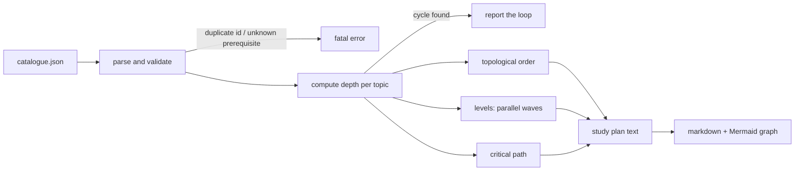
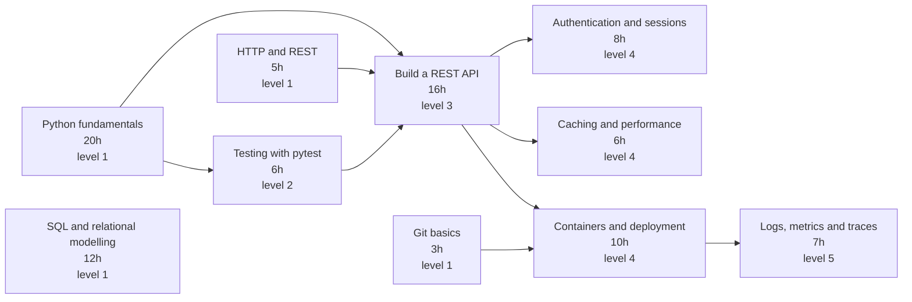

# Learning-Path-Planner

[](https://github.com/abubakarsiddique360/Learning-Path-Planner/actions/workflows/ci.yml)


Describe what you want to learn as a list of topics with prerequisites, and get back a study
order that never asks you to learn something before its foundation, a level-by-level plan you can
work through in parallel, the critical path that sets the minimum calendar time, and a Mermaid
diagram you can drop straight into a document.

```text
python(20h) -> testing(6h) -> api(16h) -> containers(10h) -> observability(7h)   = 59h critical path
```

## Why it exists

Curricula are graphs, but people write them as lists. The list hides the two things that matter:
what can be learned **in parallel** and what actually **blocks** progress. Reordering by hand is
where "I will do Kubernetes first" plans come from. This tool reads the dependency graph once and
answers three questions deterministically: what order, what runs in parallel, and what is the
longest chain.

## How it works



`depth(topic) = 1 + max(depth(prerequisite))`, so every prerequisite is guaranteed to sit on a
lower level. Sorting by `(depth, -hours, id)` therefore produces a valid topological order **and**
a stable one: the same catalogue always yields the same plan.

## Install

```bash
pip install -e .
```

Python 3.10+, zero runtime dependencies. The Markdown output renders on GitHub with no extra tools.

## Usage

```bash
learn-plan plan   examples/backend-path.json              # readable plan
learn-plan plan   examples/backend-path.json --markdown   # markdown + Mermaid graph
learn-plan plan   examples/backend-path.json --json       # machine readable
learn-plan order  examples/backend-path.json              # numbered order, one line each
learn-plan graph  examples/backend-path.json              # only the Mermaid flowchart
learn-plan stats  examples/backend-path.json              # totals per tag, critical path
learn-plan check  examples/backend-path.json              # validate; exit 1 if unplannable
```

Exit codes: `0` fine, `1` the catalogue cannot be planned (a cycle), `2` the file cannot be read
or is structurally invalid.

## The catalogue format

```json
{
  "title": "Backend engineer learning path",
  "topics": [
    { "id": "python", "title": "Python fundamentals", "hours": 20, "tags": ["language"] },
    { "id": "testing", "title": "Testing with pytest", "hours": 6,
      "requires": ["python"], "tags": ["quality"] },
    { "id": "api", "title": "Build a REST API", "hours": 16,
      "requires": ["python", "http", "testing"], "tags": ["web"] }
  ]
}
```

| Field | Required | Notes |
| --- | --- | --- |
| `id` | yes | Unique, stable, used in prerequisites and in JSON output. |
| `title` | no | Falls back to the id with a warning. |
| `hours` | no | Defaults to `1`. Must be positive; anything else becomes a warning. |
| `requires` | no | Ids that must come first. Unknown ids are a fatal error. |
| `tags` | no | Free labels used by `stats`. |
| `note` | no | Free text, passed through to JSON output. |

Structural errors are fatal because they make ordering ambiguous: duplicate ids, a topic that
requires itself, an unknown prerequisite, malformed JSON, an empty topic list. Everything else is a
warning that still produces a plan.

## Example output

```text
$ learn-plan order examples/backend-path.json
 1. [L1] Python fundamentals (20h)
 2. [L1] SQL and relational modelling (12h)
 3. [L1] HTTP and REST (5h)
 4. [L1] Git basics (3h)
 5. [L2] Testing with pytest (6h)
 6. [L3] Build a REST API (16h)
 7. [L4] Containers and deployment (10h)
 8. [L4] Authentication and sessions (8h)
 9. [L4] Caching and performance (6h)
10. [L5] Logs, metrics and traces (7h)
```

```text
$ learn-plan stats examples/backend-path.json
title        : Backend engineer learning path
topics       : 10
total hours  : 93
levels       : 5
critical path: 59h
hours by tag :
  web                  29h
  language             20h
  ops                  17h
  data                 12h
  security              8h
  performance           6h
  quality               6h
  tooling               3h
```

A cycle is reported with the loop itself, not just a boolean:

```text
$ learn-plan check examples/cyclic-path.json
error: prerequisite cycle detected: a -> c -> b -> a
```

## The generated diagram

`learn-plan plan --markdown` embeds this graph in the plan. It is exactly what `graph` prints for the
sample catalogue:



## Reading the plan

| Concept | Definition |
| --- | --- |
| Level | `1 + max(level of prerequisites)`. Topics on the same level have no dependency between them, so they can be studied in parallel. |
| Total hours | Sum of every topic, i.e. the effort if nothing is skipped. |
| Critical path | The longest chain of dependent topics, weighted by hours. This is the floor on calendar time: you cannot finish faster than this chain. |
| Level hours | Sum of the level's topics. Because a level can be parallelised, it is the wall-clock cost of that wave, not an addition on top of the previous one. |
| Hours by tag | Where the effort actually goes, useful when choosing between two plans. |

## Design notes

- **Depth instead of Kahn's algorithm.** Computing the longest distance from a root gives both the
  topological order and the parallel waves in one memoised pass, and it detects cycles for free
  because a cycle produces a back edge.
- **Deterministic tie-breaks.** Equal depths are ordered by longer topic first and then by id, so two
  people running the tool on the same catalogue get byte-identical plans and clean diffs.
- **Cycles are data, not crashes.** `check` and `plan` report the participating ids in order, so a
  reviewer sees `a -> c -> b -> a` instead of "invalid graph".
- **Mermaid node aliases are sanitised.** Real ids such as `data-pipelines` are not valid Mermaid
  node names, so they are rewritten to safe aliases while the label keeps the human title.
- **The report is a view.** `PathReport` recomputes every number from the catalogue, so text,
  markdown and JSON can never disagree.
- **No network, no dependencies.** Plans are reproducible offline and safe to run in CI.

## Project layout

```text
src/learning_path_planner/
  catalogue.py  JSON parsing, field validation, warnings
  graph.py      depths, topological order, levels, critical path, tag totals, reverse edges
  report.py     PathReport: text, markdown with Mermaid, JSON
  cli.py        plan / order / graph / stats / check
examples/
  backend-path.json   10 topics, 5 levels, 93 hours, 59h critical path
  cyclic-path.json    intentionally unplannable, used by the tests
tests/                62 tests across parsing, graph algorithms, rendering and the CLI
```

## Development

```bash
python -m pip install -e ".[dev]"
python -m pytest
python -m ruff check .
python -m ruff format --check .
```

CI runs the suite on Python 3.10 and 3.12, checks formatting, then plans, stats and graphs the sample
catalogue so the documented output cannot drift.

## Limitations

- Hours are a single number per topic; there is no per-topic confidence, deadline or cost model.
- The planner assumes all prerequisite edges have equal weight. Partially satisfiable prerequisites
  ("either A or B") are not modelled.
- Levels assume unlimited parallel capacity. With a limit of one topic at a time, follow `order`
  instead.
- Catalogue size is limited by memory only; the algorithm is linear in topics plus edges.

## License

MIT, copyright (c) 2026 ABU BAKAR SIDDIQUE.
